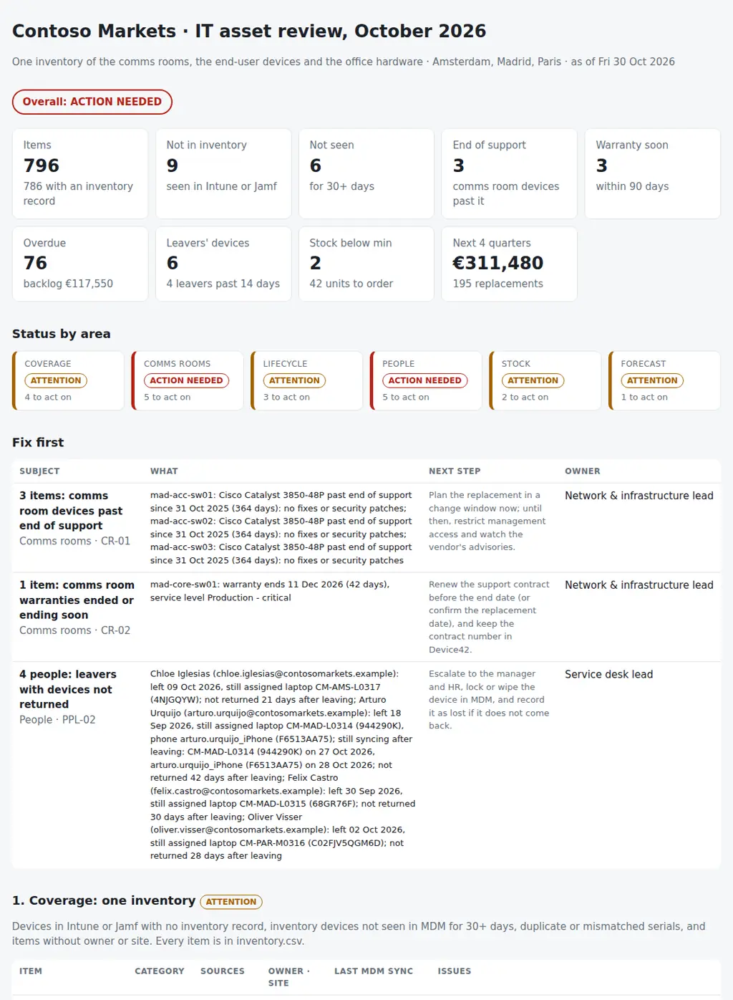

# IT Asset Lifecycle Planner

The monthly asset review of an office IT site: is every piece of hardware in the offices and the comms rooms in one inventory, with an owner, a state and a date to replace it, and what do we have to buy next quarter? From the Device42, Intune and Jamf Pro exports, the vendor's purchases, the office register, the HR roster and the stock register it puts together:

- **Coverage:** devices in Intune or Jamf missing from the inventory, inventory devices not seen in MDM for 30 days or more, duplicate and mismatched serial numbers, and items without an owner or a site.
- **The comms rooms:** devices past end of support or out of warranty, warranties ending in the next 90 days, devices without rack position or owner, and firmware not recorded in Device42.
- **Lifecycle:** one state for every item (in stock, deployed, in repair, to be retired, retired) and one replacement date from the refresh policy; what is overdue and what is due in the next two quarters.
- **People:** devices still assigned to leavers, leavers who have not returned them after 14 days, people with more devices than the policy allows, and active people without a laptop or desktop.
- **Stock:** spares below the minimum per site, and what next quarter's replacements need.
- **Forecast:** replacements by quarter for the next four quarters, units and cost by category and site, with the overdue backlog kept apart, ready for the budget.

Seven CSVs, one JSON with the policy and one Python command give each area a status (**on track**, **attention** or **action needed**), an overall verdict, and the pack for the monthly review: **what is missing from the inventory, what has to be replaced, and what it will cost.**

Python 3.10+, standard library only. It runs with fictional demo data out of the box. A read-only PowerShell exporter for Device42, Microsoft Graph (Intune) and Jamf Pro is included.



## Why

In many offices the inventory is split by who looks after it. The comms rooms are in Device42, the laptops and phones are in Intune and Jamf, the monitors and docks are in a spreadsheet, and the warranties are in the vendor's portal. Each list looks complete on its own. Put together, the gaps show:

- nine laptops in Intune that nobody registered, bought on a card or through another reseller, with no warranty record and no replacement date;
- a laptop that has not synced for 140 days, and a leaver's laptop still syncing six weeks after the last day;
- three access switches past end of support, and the core switch's warranty ending in six weeks;
- a server with no owner in Device42 and a PDU with no U position;
- monitors in Madrid's stock at three for a minimum of ten, with nineteen laptops due for replacement before the end of March;
- and 70 laptops and 24 trading desktops bought in the same months of 2022 and 2023, all due in Q2 2027: half of next year's hardware budget in one quarter.

Device42 knows the racks, MDM knows who uses what and when it last checked in, the vendor knows what was bought and until when it is covered, HR knows who left, and the register knows what is on the shelf. The review that matters joins them by serial number every month, against the refresh policy the team signed up to. The rules are in `settings.json` and `assetplan/checks.py`.

## What it checks

| Area | Code | Finding |
|---|---|---|
| Coverage | COV-01 | Company device in Intune or Jamf whose serial is in no inventory record (Device42, register, purchases); personal devices are left out |
| Coverage | COV-02 | Deployed laptop, desktop or phone not seen in MDM for `not_seen_days`, or never enrolled |
| Coverage | COV-03 | Serial on two register or purchase lines, a different model for the same serial in two sources, a placeholder serial in MDM; re-enrolment duplicates for information |
| Coverage | COV-04 | Deployed item without an owner or a site |
| Comms rooms | CR-01 | Past end of support (critical for network equipment and critical service levels); end of support within `eos_warn_days` for information |
| Comms rooms | CR-02 | Out of warranty; warranty ending within `warranty_warn_days`, critical within `warranty_critical_days` for `critical_service_levels` |
| Comms rooms | CR-03 | Racked device without rack or U position; device without owner (customer) |
| Comms rooms | CR-04 | Network equipment or server without OS or firmware version; no end-of-support date recorded (information) |
| Lifecycle | LCM-01 | Replacement date passed (purchase date plus `refresh_years`, or end of support for comms room equipment) |
| Lifecycle | LCM-02 | Replacement due in the next two quarters (information) |
| Lifecycle | LCM-03 | Item without a purchase or enrolment date: no replacement date |
| Lifecycle | LCM-04 | Retired in the register but still syncing with MDM; spare in stock past its replacement date (information) |
| People | PPL-01, PPL-02 | Devices assigned to a leaver: pending within `leaver_return_days`, critical after it (with sign of use after leaving) |
| People | PPL-03 | More devices of a category than `max_per_person` |
| People | PPL-04 | Active person with no laptop or desktop |
| People | PPL-05 | Devices assigned to someone HR does not know |
| Stock | STK-01 | Stock below the minimum; critical at zero |
| Stock | STK-02 | Replacements due by the end of next quarter beyond the stock above the minimum: what to order |
| Forecast | FC-01 | Backlog, rest of the quarter and the next `forecast_quarters` quarters (information) |
| Forecast | FC-02 | One quarter with `wave_share` or more of the forecast cost: a refresh wave |

## Outputs

| File | What |
|---|---|
| `report.html` | Overall verdict, tiles, status by area, "Fix first", and one section per area with its status: coverage, comms rooms, lifecycle by category and state, people, stock, the forecast by quarter, category and site, and all findings |
| `asset-review.md` | The pack for the monthly review: status by area, headlines, sources and record counts, the refresh policy, the forecast for the budget (by category and by site, backlog apart), stock orders, findings, actions and sign-off |
| `inventory.csv` | The one inventory: every item with its sources, site, owner, state, purchase, warranty, end of support, replacement date and last MDM sync |
| `coverage.csv` | Items missing, not seen, with serial problems or without owner or site |
| `comms-rooms.csv` | Every Device42 device with location, owner, firmware, warranty and end of support, and days left |
| `lifecycle.csv` | Items overdue or due in the next two quarters, and state inconsistencies |
| `people.csv` | Every person in HR with the devices assigned, and the issues |
| `stock-plan.csv` | Per site and item: on hand, minimum, due by the end of next quarter, backlog and to order |
| `forecast.csv` | Units and cost by quarter, site and category (backlog as `overdue`) |
| `actions.csv`, `findings.csv` | The findings with owner and next step, ready for a tracker |

## Try it

```bash
git clone https://github.com/inigogonzalezgarcia/38-it-asset-lifecycle-planner.git
cd 38-it-asset-lifecycle-planner
python -m assetplan demo
```

Open `output/report.html` and `output/asset-review.md`.

### The demo data

The demo is a made-up broker, Contoso Markets, reviewed on Friday 30 October 2026:

- three offices: Madrid (120 people and a trading floor), Paris (45) and Amsterdam (25), with comms rooms in Madrid and Paris;
- 51 Device42 devices (core and access switches, routers, firewalls, servers, PDUs, UPS and patch panels), 298 Intune and 19 Jamf Pro devices, 740 purchase lines from Dell, an Apple reseller and a mobile operator, and 457 office register lines (monitors, docks, meeting rooms, printers, spares and repairs);
- 198 people in HR, 8 of them leavers, and the stock of 13 items across the three sites.

All names, serials and orders are fictional; the end-of-support dates are illustrative. The problems are placed on purpose:

- **Coverage:**
  - nine laptops in Intune with no purchase and no register line (six in Madrid, two in Paris, one in Amsterdam);
  - four laptops not seen for 38 to 140 days and one bought in 2025 that was never enrolled;
  - a monitor typed twice in the register, a laptop with a different model in Intune and in the order, and a meeting room PC reporting its serial as "To be filled by O.E.M.";
  - three monitors with no site and two docks with nobody.
- **Comms rooms:** three Catalyst 3850 access switches past end of support, the core switch's warranty ending in 42 days, two Paris servers out of warranty in January, a server without owner, a PDU without U position, a patch panel without rack, and two switches with no firmware recorded.
- **Lifecycle:** 76 items overdue (old laptops, monitors and docks, four servers, the Paris UPS batteries), a laptop retired in the register that is still syncing with Intune, an old spare still in stock, and two items with no purchase date.
- **People:** five leavers with laptops, four of them past the 14 days, one still syncing six weeks after leaving and still holding a company iPhone; two people who kept their old laptop after the refresh, one with three monitors, three joiners without a computer, and a dock lent to a contractor HR does not know.
- **Stock:** Madrid monitors at 3 for a minimum of 10, Paris docks below the minimum, and 19 Madrid laptops due by 31 March 2027 with one spare above the minimum.
- **Forecast:** €117,550 of overdue backlog, and a refresh wave in Q2 2027 (71 laptops and 24 trading desktops) that is half of the next four quarters' €311,480.

## Use it with your own data

1. Export Device42, Intune and Jamf Pro (read-only):
   ```powershell
   .\scripts\Export-AssetData.ps1 -OutputFolder .\data -Device42Url https://device42.corp.contoso.com -JamfUrl https://contoso.jamfcloud.com -JamfClientId <client id>
   ```
   - Device42: `GET /api/1.0/devices/all/` with `limit` and `offset` until `total_count`, basic authentication from `Get-Credential`, never stored.
   - Intune: `Get-MgDeviceManagementManagedDevice -All` (Microsoft Graph `GET /deviceManagement/managedDevices`) with the delegated permission DeviceManagementManagedDevices.Read.All.
   - Jamf Pro: a token from an API client (`POST /api/oauth/token`) or a user (`POST /api/v1/auth/token`), then the computers inventory with the GENERAL, HARDWARE, USER_AND_LOCATION and OPERATING_SYSTEM sections, page by page.
2. Add the files that live elsewhere: `purchases.csv` from the vendor's order or warranty report, `office-register.csv`, `hr.csv` and `stock.csv`.
3. Adjust `data/settings.json`: refresh years and unit costs per category, the end-of-support dates of your comms room models, the device policy per person and the site names ([docs/data-format.md](docs/data-format.md)).
4. Build the outputs:
   ```bash
   python -m assetplan review data/ --title "IT asset review · October 2026"
   ```

[docs/monthly-asset-review-runbook.md](docs/monthly-asset-review-runbook.md) has the export, what to fix the same day, the agenda of the monthly review and how to read each signal.

The exports contain names, serial numbers, locations and costs. Keep them inside your organisation:

- real files at the top level (`device42*.csv`, `intune*.csv`, `jamf*.csv`, `purchases*.csv`, `office-register*.csv`, `hr*.csv`, `stock*.csv`, `settings.json`, `data/`) and the `output/` folder are excluded from Git by `.gitignore`;
- only the fictional files in `sample_data/` are committed.

## Tests

```bash
pip install -r requirements-dev.txt
python -m pytest -q
```

GitHub Actions runs them on Python 3.10 and 3.12 on every push, then rebuilds the fictional sample data and the report screenshot from the simulator.

14 tests: Device42, Intune and Jamf Pro exports with API column names and semicolons; purchases, register and HR files in Spanish, prices with thousands separators and placeholder serials; settings, quarters and the required files; the one inventory joined by serial (sources, site and owner); devices missing from the inventory and personal devices; not seen, duplicates, model mismatches, placeholders and items without owner or site; end of support, warranty, rack position, owner and firmware in the comms rooms; states, replacement dates (purchase, end of support, estimated from enrolment) and inconsistencies; leavers, the device policy, people without a computer and unknown users; stock against the minimum and next quarter; the forecast buckets, costs and the refresh wave; status by area and overall; and the demo end to end (deterministic, all eleven outputs).

## Next steps

- Read the purchases and warranties from the vendor's API by service tag, instead of a CSV.
- Write the end-user devices back to Device42 by serial, so Device42 becomes the one inventory for the whole office and not only the comms rooms; this report then checks it rather than building it.
- Compare each month with the previous one: new items, items gone, and the backlog going up or down.
- Joiners' start dates from HR in the stock check, so next quarter's order covers the new starters as well as the replacements.

## Background

Built from my work running an office IT site:

- Device42 for the inventory of the comms rooms (racks, network equipment, servers); extending one inventory to all the office hardware is the idea behind this tool;
- an operations console for inventory and asset control with PowerShell automation; Cisco switches and routers, comms rooms and racks; Dell, HP and Supermicro servers;
- macOS, iOS, Android and Windows managed with Intune and Jamf Pro, and hardware validation and certification;
- the vendor relationship with Dell for hardware and renewals, connectivity, hardware and service vendors, SAM and licence and cost control, and CMDB and configuration management;
- preparing and tracking the annual IT budget in a multi-site company, and supporting about 2,500 users across European offices.

Written from scratch with fictional data; no employer data, systems or exports are used.

## Customisation and contact

Want this adapted to your offices? For example:

- your Device42, Intune and Jamf Pro exports and your vendor's warranty report;
- your refresh policy, unit costs and the device policy per person;
- your sites, stock levels and the order sent to the vendor each quarter;
- the forecast in the format of your budget.

Get in touch:

- Website (contact form): [inigogonzalezgarcia.github.io](https://inigogonzalezgarcia.github.io/about.html#contacto)
- LinkedIn: [linkedin.com/in/igonzalez93](https://www.linkedin.com/in/igonzalez93)

## License

MIT
